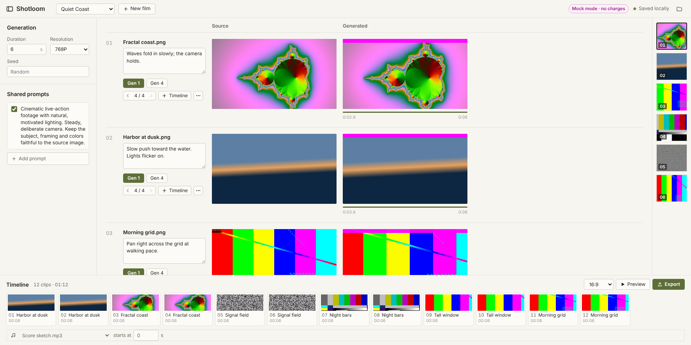

# Shotloom

A local, folder-based editor for making short films from still images:
organize source images into films, describe each shot, generate video
variations, compare them, trim the useful part, arrange a timeline, add a
soundtrack, and export a finished MP4.

The interface runs in your browser, and the server runs only on your
computer. It listens on `127.0.0.1` and refuses requests addressed to any other
host.

> **What leaves your computer.** Your films, prompts, clips and exports stay
> on your disk. With **real generation** (fal.ai), each **Gen 1** uploads that
> shot's source image and its assembled prompt to fal and **is billed to your
> fal account**. **Gen 4** sends four separate billable requests. **Mock mode**
> sends nothing anywhere and costs nothing.



Inspired by the workflow of
[neilsonnn/datacenter-film](https://github.com/neilsonnn/datacenter-film). See
[NOTICE.md](NOTICE.md).

---

## Windows setup

You need Windows 10 (1809) or later, **Bun**, and **FFmpeg**.

1. **Get the code.** Use **Code → Download ZIP** on GitHub and unzip it, or run:
   ```powershell
   git clone https://github.com/Z11nx/shotloom.git
   ```
2. **Install Bun.** Open PowerShell and run:
   ```powershell
   powershell -c "irm bun.sh/install.ps1|iex"
   ```
3. **Install FFmpeg** (includes `ffprobe`):
   ```powershell
   winget install Gyan.FFmpeg
   ```
   Close and reopen the terminal afterwards so `ffmpeg` is on PATH. If you use
   a downloaded build instead, set `FFMPEG_PATH` and `FFPROBE_PATH` in `.env`.
4. **Configure.** In the `shotloom` folder, copy `.env.example` to `.env`. It
   starts in mock mode. (If you skip this, the launcher creates `.env` for you
   on first start. When an update adds a new setting, the launcher appends it
   to your `.env` at its default value, without changing your existing lines.) For real generation, set:
   ```ini
   GENERATION_PROVIDER=fal
   FAL_KEY=your-fal-key
   ```
   To see your remaining fal credits in the top bar, also set
   `FAL_BILLING_KEY` to a read-only key created in fal's dashboard with the
   **BILLING** preset. Without it, Shotloom tries `FAL_KEY`, which works only
   if that key is allowed to read billing; otherwise the top bar says
   "credits unavailable" and its tooltip explains why.
5. **Start.** Double-click `start-windows.cmd`, or run this from the `shotloom`
   folder:
   ```powershell
   bun install
   bun run launch
   ```
   The launcher checks ffmpeg/ffprobe (honoring `FFMPEG_PATH` and
   `FFPROBE_PATH`), builds the interface, starts the server, and opens
   `http://localhost:<PORT>` (8787 unless you set `PORT` in `.env`). Keep the
   window open while you work and press Ctrl+C to stop. `bun run start` also
   works, but doesn't open a browser.

macOS and Linux use the same commands, after installing Bun and FFmpeg with
your package manager.

## Using it

1. Click **New film**. Its folder opens in File Explorer.
2. Put JPG, PNG or WebP images in that folder. They appear as shots within a
   couple of seconds, with no restart. GIFs are listed but not sent for
   generation, because fal documents no GIF support.
3. Edit **Prompt blocks** on the left. Enabled blocks are prepended, in order,
   to every shot's description in this film. **Show text that will be sent**
   previews the exact submission.
4. Describe a shot, then click **Gen 1** (your seed, or random) or **Gen 4**
   (four independent requests with random seeds).
5. Generated clips play on a silent loop while they're on screen. Each clip
   is used at the length you asked for. fal often returns a little extra
   (about 5.2 s for 5 s), and Shotloom ignores that tail in the preview, the
   timeline and exports; the downloaded file itself is kept unchanged. The green
   bar under each clip shows the part that plays (all of it unless trimmed),
   and a black playhead appears on it while your pointer is over the clip. Use
   **‹ ›** to compare variations. Hover over a clip to hear it; move across
   it to scrub, and it plays on from where the pointer rests. Drag across it
   to set in/out points, or type them under **More actions**. **Use full
   clip** resets the trim. Click a clip (or press Enter when it has keyboard
   focus) to enlarge it with sound; Esc closes and ← → step through
   variations. Space pauses or resumes the clip under the pointer.
6. Use **Add to timeline**, then reorder by dragging or with the arrows. Mute
   clip audio per clip.
7. Pick a **Soundtrack** from audio files in the film folder (MP3, WAV, M4A,
   AAC, OGG, FLAC) and its start offset. Choose a **Frame**: 16:9, 1:1 or 9:16.
8. **Preview** renders and plays the film. **Export** saves a numbered MP4 in
   the film's `exports` folder.

Generation keeps running if you close the browser. If the app restarts,
accepted requests resume polling automatically. A request interrupted during
submission is marked **Submission uncertain** and never resubmitted
automatically (see [docs/ARCHITECTURE.md](docs/ARCHITECTURE.md)).

## Commands

| Command | What it does |
| --- | --- |
| `bun run launch` | What `start-windows.cmd` runs: checks, build, serve, open the browser at `PORT` |
| `bun run start` | Build the interface and serve everything on `PORT` (default 8787) |
| `bun run serve` | Serve without rebuilding |
| `bun run dev` | Development: API with auto-restart plus Vite on <http://localhost:5173> |
| `bun run check` | Type check, all automated tests, production build (never contacts fal) |
| `bun test` | Automated tests only |
| `bun run build && bun run tests/browser/screens.ts tests/.tmp/screens` | Builds a disposable mock film and saves layout screenshots and measurements at 1774×887, 1920×1080 and 1366×768 |
| `bun run test:browser` | Build, then run the browser regression scenarios in mock mode. Uses bundled Chromium if installed, otherwise Microsoft Edge or Chrome (set `SHOTLOOM_BROWSER` to a browser path to override) |
| `bun run smoke:live -- image.jpg --yes-spend-money` | **Optional, paid:** one real 5 s / 480P fal request |

## fal credits

In real-generation mode the top bar shows your fal credit balance, for
example **fal.ai · $24.50 credits**. It updates every minute, when you return
to the window, and a few seconds after each clip finishes. Under $1 it turns
amber and says **low**. The lookup sends only your billing (or fal) key to
`api.fal.ai`, from the server; the browser only ever sees the number. Mock
mode never looks it up.

## Mock mode

`GENERATION_PROVIDER=mock` is the default in `.env.example`. A magenta
**Mock mode · no charges** label stays in the top bar. Mock clips are made
locally with FFmpeg: a slow pan over your image with a magenta bar across the
top and a test tone. They move through the same queued, processing and
downloading steps as real jobs.

Mock mode is never used as a fallback. If real generation is selected and
fails or lacks a key, you get an error, not a mock clip. To exercise failure
paths, put one of these tokens in a shot description:

| Token | Effect |
| --- | --- |
| `mock:fail` | The job fails when its result is fetched |
| `mock:reject` | The submission is rejected outright |
| `mock:flaky` | The first two status checks fail, then it recovers |
| `mock:silent` | The clip has no audio stream |

Jobs remember which provider created them. Switching modes later never
redirects an existing job.

## Storage and backups

Everything lives under the films folder (`FILMS_ROOT`, default `./films`).
Each film is self-contained, so to back up a film, copy its folder. Back it up
while Shotloom is stopped, or at least while nothing is generating or
rendering. Details, including how to restore, are in
[docs/STORAGE.md](docs/STORAGE.md).

`.gitignore` keeps `.env`, `films/`, generated clips, renders and `dist/` out
of version control.

## Troubleshooting

- **“FFmpeg is missing” banner.** Install FFmpeg (step 3) and restart, or set
  `FFMPEG_PATH` and `FFPROBE_PATH`.
- **“Generation off: FAL_KEY is not set.”** Add the key to `.env` and restart.
  Editing, trimming and export still work without a key.
- **“Film can't be opened.”** The film's `state.json` is unreadable. It was
  left untouched. Fix it, restore `state.prev.json`, or choose
  **Start fresh (keeps the old file)**.
- **“… goes through a link or junction that points outside it.”** A film
  folder, or a folder inside it (`.shotloom`, `exports`), is a link to
  somewhere outside `FILMS_ROOT`. Shotloom refuses to read or write through it.
  Replace the link with a real folder, or point `FILMS_ROOT` at the folder you
  want. A `FILMS_ROOT` that is itself a link is fine.
- **“Shotloom is already running for this films folder.”** Only one server
  may use a films folder at a time. Close the other window. If it's truly not
  running, delete `films/.shotloom/server.lock`.
- **A clip shows “This browser can't play this clip.”** Use Chrome, Edge or
  Firefox; output is H.264 MP4.

## More documentation

- [docs/ARCHITECTURE.md](docs/ARCHITECTURE.md): modules, job lifecycle, render pipeline, safety
- [docs/API.md](docs/API.md): HTTP routes and types
- [docs/STORAGE.md](docs/STORAGE.md): folder layout, backup, restore
- [docs/FUTURE.md](docs/FUTURE.md): adding models, motion controls, deferred features
- [docs/VALIDATION.md](docs/VALIDATION.md): what was tested, and what was not

## License

[MIT](LICENSE). Generated videos are subject to fal's and the model
provider's terms; check them before using output commercially.
